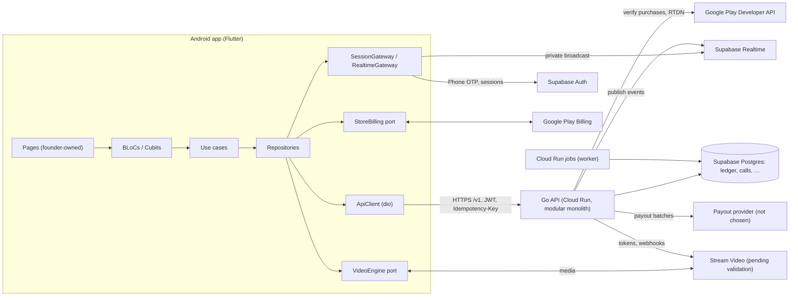

# Dashuri — Architecture overview

- **Status:** foundation scaffold, 2026-11-17.
- **Compiles and passes checks:** yes (see "Validation" below).
- **Implements production features:** no. Every server operation returns `501 not_implemented` until it is built. Client integrations (Play Billing, Stream Video) are documented skeletons.

## What Dashuri is (architecturally relevant decisions)

From `docs/business-model-report.md` v0.3 and `docs/discovery-log.md` v4. Only founder-confirmed decisions are treated as requirements.

| Requirement | Source | Where it lives |
|---|---|---|
| Paid one-to-one video; customers browse online hosts and call at the host's rate | C2, C12, C13 | `feature_discovery`, `feature_video_call`; backend `discovery`, `calls` |
| Per-second billing, starts only when both streams connect, 60 s minimum balance, 30 s warning, pause on qualifying interruptions, refund on failed connection, charge rounded once in the customer's favour | C20, C21, S6 | backend `calls` (metering) + `economy` (rules) |
| 16,670 Diamonds spent = 10,000 Beans; 1 Bean = ₹0.005 | S3 | `economy.Rules`, `economy.rule_sets` |
| Weekly payouts, ₹500 minimum, 7-day hold; payouts only after incorporation + provider onboarding | C19, R3-6, R3-7 | backend `payouts`, worker jobs; `PAYOUTS_ENABLED=false` |
| Purchased Diamonds never expire; promotional Diamonds expire after 30 days; non-transferable; Beans never expire; reversals on refunds, chargebacks, fraud | S5 | ledger templates, `expire-promo-diamonds` job |
| XP = 8 × eligible Diamonds purchased + eligible Beans earned; one shared level; host rate cap depends on level | R3-3, S8, S2 | `ledger.xp_events`, `economy.Rules` |
| Free Call Card: Android only, opt-in hosts, 20 per host per day, ₹10 host compensation, one per phone and device | S4 | backend `freecall`; `feature_free_call` |
| Minor protection mandatory; nudity bot in first 3 minutes, then report-based | S7 | backend `moderation`, `safety`; `feature_safety` |
| Android first; iOS-ready architecture | R3-2, S10 | Flutter app has both platforms; Free Call Card disabled on iOS |
| Host independence: no quotas, free to decline or end | C14, C15 | No such controls exist anywhere in the code |

**Unresolved items** are kept as configuration or explicit TODOs, not assumed: level thresholds and rate ladder, interruption threshold, Diamond spend order, Bean rounding residue, payout provider, KYC vendor, moderation vendor, Pvt Ltd vs OPC.

## System at a glance



## Repository layout

```text
dashuri/
├── pubspec.yaml               # pub workspace + Melos 8 config (melos.yaml no longer exists in Melos 7+)
├── analysis_options.yaml
├── apps/mobile/               # Flutter app = composition root only (bootstrap, DI, router)
├── packages/
│   ├── lints/                 # shared analysis rules
│   ├── core/                  # pure Dart: Result, Failure, UseCase, units, config, SessionGateway contract, IdempotencyKey
│   ├── network/               # ApiClient (dio), problem+json mapping, RealtimeGateway contract
│   ├── supabase/              # the ONLY package importing supabase_flutter
│   ├── storage/               # key-value + secure storage
│   ├── navigation/            # RoutePaths, FeatureRoutes, RouteGuard (go_router)
│   ├── design_system/         # tokens → Material 3 theme → shared components (visuals are founder-owned)
│   └── features/              # auth, profile, discovery, free_call, video_call, chat, wallet,
│                              # purchases, host, safety, notifications, settings
├── backend/                   # Go modular monolith (cmd/api, cmd/worker, internal/…)
├── api/openapi/dashuri.v1.yaml  # API contract
├── supabase/                  # config.toml, migrations, DB tests
├── infrastructure/            # Cloud Run templates, environment plan
├── scripts/                   # bootstrap.sh, validate.sh, validate-migrations.sh
├── tool/                      # check_dependencies.dart, new_feature.dart
├── simulation/                # financial simulation (separate, earlier work)
└── docs/                      # business model, discovery log, simulation, architecture
```

## Documents

| Document | Covers |
|---|---|
| [system-context.md](system-context.md) | Actors, external systems, trust boundaries |
| [flutter-architecture.md](flutter-architecture.md) | Packages, layers, BLoC/DI/routing conventions, how to add a feature |
| [page-integration-guide.md](page-integration-guide.md) | Where each page goes and how it connects |
| [dependency-rules.md](dependency-rules.md) | Allowed dependencies, enforced by `tool/check_dependencies.dart` |
| [backend-architecture.md](backend-architecture.md) | Go modules, layers, middleware, jobs, errors |
| [database-architecture.md](database-architecture.md) | Schemas, ownership, RLS, roles, Realtime, Storage, what may use Supabase directly |
| [financial-ledger-design.md](financial-ledger-design.md) | Double-entry ledger, wallets, holds, payouts, XP, locking, reconciliation |
| [video-call-architecture.md](video-call-architecture.md) | Call lifecycle, server-authoritative metering and settlement |
| [security-architecture.md](security-architecture.md) | AuthN/Z, secrets, abuse prevention, moderation, privacy |
| [api-contracts.md](api-contracts.md) | Endpoint catalogue, errors, idempotency |
| [testing-strategy.md](testing-strategy.md) | Test pyramid, financial and concurrency tests |
| [deployment-architecture.md](deployment-architecture.md) | Environments, Cloud Run, CI/CD, migrations |
| [decisions/](decisions/) | ADRs |

## Validation

What was run on 2026-11-17, and the outcome:

| Check | Command | Result |
|---|---|---|
| Static analysis | `dart analyze --fatal-infos apps packages tool` | No issues |
| Dependency rules | `dart run tool/check_dependencies.dart` | OK |
| Dart/Flutter tests | `melos run test` | All pass (19 packages) |
| Android build | `flutter build apk --debug` | Built |
| Go format, vet, race tests, build | see `scripts/validate.sh` | Pass (5 test packages) |
| Migrations + DB invariants | `scripts/validate-migrations.sh` | 6 migrations applied, 11 invariants pass |
| OpenAPI structure | generator self-check (refs resolve, unique operationIds, path params) | OK. An external linter was not run. |
