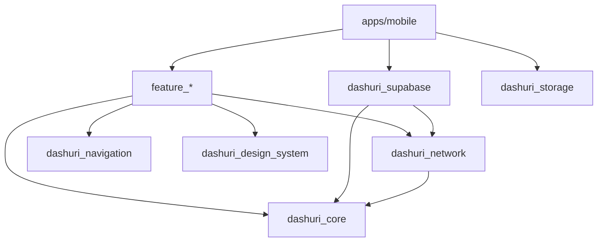

# Dependency rules

Enforced by `dart run tool/check_dependencies.dart` (`melos run deps:check`), which runs in `scripts/validate.sh`.

## Package graph (Flutter)



| Rule | Statement |
|---|---|
| R1 | Only `packages/supabase` may depend on `supabase_flutter`. |
| R2 | A feature never depends on another feature. Cross-feature navigation uses `RoutePaths`; shared types belong in `dashuri_core`. |
| R3 | `domain/` is pure Dart: no Flutter, no `dashuri_network`, no `data/` imports. |
| R4 | `application/` (BLoCs) uses use cases only, never data sources or `ApiClient`. |
| R5 | `presentation/` (pages, widgets) reads BLoC state; no `data/`, `dashuri_network` or `get_it` imports. |
| R6 | Only `packages/network` imports `dio`. |
| R7 | `dashuri_core` never imports Flutter. |

## Layer rules inside a feature

```text
presentation ──▶ application ──▶ domain ◀── data
                                   ▲
                       (data implements domain contracts)
```

| Layer | May depend on | Must not |
|---|---|---|
| Domain (entities, repository contracts, use cases, ports) | `dashuri_core`, `equatable` | Flutter, HTTP, Supabase, store or video SDKs |
| Data (data sources, JSON mappers, repository implementations, provider adapters) | domain, `dashuri_network`, platform SDKs | presentation, application |
| Application (BLoCs/Cubits) | domain use cases and entities | data, network |
| Presentation (pages, widgets) | application, `dashuri_design_system`, `dashuri_navigation` | data, network, DI lookups (BLoCs come from routes) |
| Wiring (`di/`, `routes/`) | everything in the feature | — |

## Backend (Go)

- `internal/platform/*` knows nothing about modules.
- A module may import `platform/*`, `economy` and `ledger`. Modules do not import each other's internals; cross-module calls go through small interfaces declared by the caller (ports).
- Vendor SDKs live only in `internal/adapters/<vendor>`.
- Only `internal/app` imports every module (composition root).
- Go has no automatic checker yet. Add a `go list`-based check before the module count grows.
