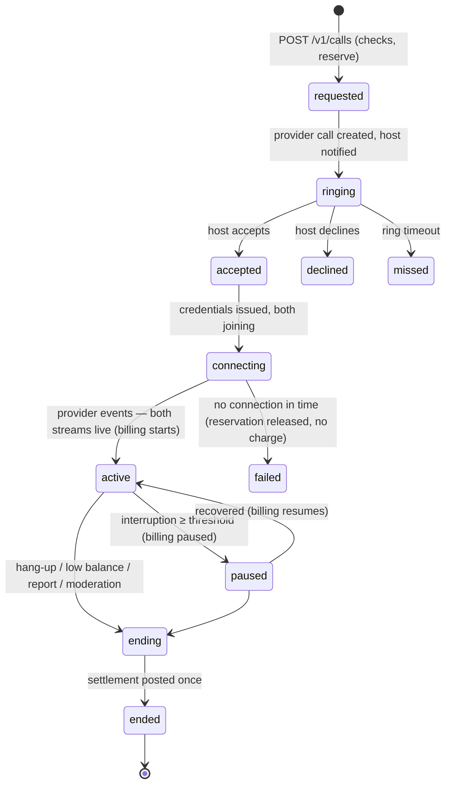

# Video-call architecture

**Principle: the server is authoritative.** The Flutter client never decides whether a call may start, never measures billable time and never says how many Diamonds to take.

## Components

| Component | Role |
|---|---|
| `feature_video_call` (`CallBloc`, `VideoEngine` port) | Orchestrates on the device: API calls, joining media, showing server state |
| Video provider (Stream Video, pending validation; ADR-005) | Media transport; issues server-side webhooks |
| Go `calls` module | Authorisation, lifecycle, provider tokens, metering from webhooks, reservations, settlement |
| Supabase Realtime | `call.updated`, `call.low_balance` to `call:<id>` and `user:<id>` |
| Postgres | `calls.calls`, `calls.media_events`, `calls.settlements`, `ledger.diamond_reservations` |

## Lifecycle



Transitions are validated by `calls.Transition` and persisted with an optimistic check (`UPDATE … WHERE id = $1 AND phase = $from`), so concurrent events cannot both win.

## Sequence: paid call

```mermaid
sequenceDiagram
  participant C as Customer app
  participant API as Go API
  participant DB as Postgres
  participant V as Video provider
  participant H as Host app
  C->>API: POST /v1/calls {host_user_id} (Idempotency-Key)
  API->>DB: lock balances, check 60 s, reserve, insert call
  API->>V: create 1:1 call
  API-->>H: Realtime user:host — call.updated (ringing) + push
  H->>API: POST /v1/calls/{id}/accept
  C->>API: POST /v1/calls/{id}/credentials
  H->>API: POST /v1/calls/{id}/credentials
  C->>V: join (token)
  H->>V: join (token)
  V->>API: webhooks: joined, video published
  API->>DB: media_events; phase active (billing starts now)
  API-->>C: call.updated (active)
  loop while active
    V->>API: webhooks (left/rejoined…)
    API->>DB: extend reservation if balance allows
    API-->>C: call.low_balance (30 s left)
  end
  C->>API: POST /v1/calls/{id}/end {reason} (Idempotency-Key)
  API->>DB: BillableSeconds(events) → charge → CallSettlement + settlements + release reservation (1 tx)
  API->>V: end call
  API-->>C: call.updated (ended, billed_seconds, diamonds_charged)
```

## Metering

`calls.BillableSeconds(changes, end, threshold)` (tested):
- input is the server-observed timeline of whether **both** participants are connected with video, built only from provider webhooks;
- billing starts at the first moment both are live (S6);
- gaps shorter than the threshold are billed (blips); gaps at or above it are excluded (paused);
- events after the end are ignored; the result is whole seconds, rounded down.

The 10-second threshold is a **technical assumption** to tune with real data, not a founder decision.

## Abuse and failure cases

| Threat or failure | Prevention |
|---|---|
| Client fakes duration or amount | The API accepts no duration or amount; settlement uses provider webhooks only |
| Billing before connection | Billing starts only on the server-observed "both live" event |
| Duplicate settlement | Unique `calls.settlements(call_id)` and ledger key `call_settlement:<id>`; `/end` is idempotent |
| Replayed requests | `Idempotency-Key` on request and end; webhook event ids are the primary key of `media_events` |
| Concurrent wallet spending | One live call and one active reservation per user; balance rows locked; non-negative balance CHECK |
| Spoofed webhooks | Provider signature verified over the raw body before processing |
| Joining someone else's call | Provider tokens are per user and per call, short-lived, and issued only to participants |
| Host leaves without hanging up | No events past the timeout → `settle-stale-calls` ends and settles |
| Network blips | Below threshold: billed. Above: paused, and credited automatically by exclusion (C21) |
| Never connects | Phase failed; reservation released; no charge (S6) |
| Low balance | Warning 30 s before; server ends the call at zero |
| Report during a call | The client ends the call, then reports; the server attaches the call id; evidence retention is triggered |
| Rate changed mid-call | Rate is snapshotted when the call is created |

## Free calls

Same lifecycle with `is_free_call = true`: no reservation, a 60-second server cap, Android only. Host compensation (₹10 = 2,000 Beans) is posted only for an eligible free-call minute, as confirmed by the server. Match selection and the 20-per-day cap are enforced in the database.

## Moderation hook (S7)

During the first 3 minutes after `active`, the moderation module samples frames (the source is unresolved; see security architecture), scores them with `NudityClassifier`, and may end the call and open a case. After 3 minutes, moderation is report-based. **This design does not by itself establish legal or Google Play compliance**, which is still pending a lawyer's review.

## Provider validation checklist (before adding the Stream SDK)

- [ ] Server-side webhooks for participant join/leave and track publish/unpublish, with signatures and event ids.
- [ ] Call-scoped, short-lived user tokens; ability to restrict a call to two users.
- [ ] Server-side force-end of a call.
- [ ] Server access to frames, or recording of the first 3 minutes for moderation (or confirm client capture is needed).
- [ ] Pricing at the expected volume, India latency, Android SDK size and minimum SDK.
- [ ] Data-processing terms acceptable under DPDP.
